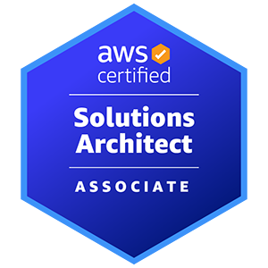

# AWS Cloud Architecture Handbook

A practical handbook for engineers who design, build, and run systems on AWS. It summarizes core services, their limits and defaults, and Well-Architected Framework guidance. Last reviewed in November 2026.

## Table of Contents

- [Amazon Elastic Compute Cloud (EC2)](#amazon-elastic-compute-cloud-ec2)
- [Amazon Elastic Container Service (ECS)](#amazon-elastic-container-service-ecs)
- [Amazon Elastic Container Registry (ECR)](#amazon-elastic-container-registry-ecr)
- [Amazon Elastic Kubernetes Service (EKS)](#amazon-elastic-kubernetes-service-eks)
- [AWS Lambda](#aws-lambda)
- [Amazon Virtual Private Cloud (VPC)](#amazon-virtual-private-cloud-vpc)
- [Amazon Route 53](#amazon-route-53)
- [Amazon Elastic Load Balancing (ELB)](#amazon-elastic-load-balancing-elb)
- [AWS Transfer Family](#aws-transfer-family)
- [AWS Direct Connect](#aws-direct-connect)
- [Amazon Simple Storage Service (S3)](#amazon-simple-storage-service-s3)
- [Amazon Elastic Block Store (EBS)](#amazon-elastic-block-store-ebs)
- [Amazon Elastic File System (EFS)](#amazon-elastic-file-system-efs)
- [Amazon Relational Database Service (RDS)](#amazon-relational-database-service-rds)
- [Amazon Aurora](#amazon-aurora)
- [Amazon DynamoDB](#amazon-dynamodb)
- [Amazon Redshift](#amazon-redshift)
- [Amazon Simple Queue Service (SQS)](#amazon-simple-queue-service-sqs)
- [Amazon Simple Notification Service (SNS)](#amazon-simple-notification-service-sns)
- [Amazon API Gateway](#amazon-api-gateway)
- [Amazon Cognito](#amazon-cognito)
- [Amazon CloudWatch](#amazon-cloudwatch)
- [AWS CloudTrail](#aws-cloudtrail)
- [AWS Identity and Access Management (IAM)](#aws-identity-and-access-management-iam)
- [AWS Key Management Service (KMS)](#aws-key-management-service-kms)
- [AWS Security Hub](#aws-security-hub)
- [AWS CloudFormation](#aws-cloudformation)
- [AWS Systems Manager](#aws-systems-manager)
- [AWS Well-Architected Framework](#aws-well-architected-framework)
- [AWS Cost Optimization Strategies](#aws-cost-optimization-strategies)
- [Amazon EventBridge](#amazon-eventbridge)
- [AWS Step Functions](#aws-step-functions)
- [Amazon Kinesis](#amazon-kinesis)
- [Amazon GuardDuty](#amazon-guardduty)
- [Amazon Inspector](#amazon-inspector)
- [Amazon Macie](#amazon-macie)
- [AWS IAM Access Analyzer](#aws-iam-access-analyzer)
- [AWS CodePipeline](#aws-codepipeline)
- [AWS CodeBuild](#aws-codebuild)
- [AWS CodeDeploy](#aws-codedeploy)
- [AWS CodeCommit](#aws-codecommit)
- [Contributing](#contributing)
- [License](#license)

## Amazon Elastic Compute Cloud (EC2)

Amazon EC2 provides resizable virtual server capacity in the cloud. Key concepts:

- **Instance Types** (named by family; the generations within each family change over time, so check the current instance types list):
  - General Purpose (M, T)
  - Compute Optimized (C)
  - Memory Optimized (R, X, U)
  - Accelerated Computing (P, G, Trn, VT)
  - Storage Optimized (I, Im, Is)

- **Pricing Models**:
  - On-Demand (no commitment)
  - Savings Plans (1- or 3-year hourly spend commitment; applies across accounts in an AWS Organization, and does not reserve capacity)
  - Spot Instances (up to 90% off On-Demand prices)
  - Reserved Instances (1- or 3-year billing discount; a zonal RI also reserves capacity in its Availability Zone)
  - Dedicated Hosts (physical servers for your use)
  - Dedicated Instances (EC2 instances on single-tenant hardware)
  - Capacity Reservations (reserve capacity in a specific Availability Zone with no term commitment; no billing discount of their own, but Savings Plans and Regional RIs apply to them)

- **Advanced Features**:
  - Nitro System (enhanced security & performance)
  - Elastic Fabric Adapter (EFA) for HPC and ML networking
  - Capacity Blocks for ML (reserved GPU capacity for a fixed start time and duration)
  - EC2 Instance Connect for browser-based SSH
  - EC2 Fleet and Spot Fleet (launch On-Demand and Spot capacity across instance types and Availability Zones in one request)

- **Best Practices**:
  - Use Instance Metadata Service (IMDSv2) for enhanced security
  - Enable Detailed Monitoring for 1-minute metrics (CloudWatch)
  - Leverage Placement Groups (Cluster, Spread, Partition) for specific workload needs
  - Utilize EC2 Auto Scaling for elasticity and high availability
  - Implement AWS Systems Manager for operational automation
  - Continuously monitor and optimize costs using AWS Cost Explorer and Compute Optimizer

## Amazon Elastic Container Service (ECS)

Amazon ECS is a managed container orchestration service that supports Docker containers. ECS enables you to deploy, manage, and scale containerized applications. ECS provides a variety of features to help you manage your containerized applications, including:

- **Service discovery:** Service Connect and AWS Cloud Map let services find each other by name.
- **Load balancing:** ECS services register tasks with Application or Network Load Balancer target groups.
- **Health monitoring:** The ECS service scheduler replaces tasks that fail container or load balancer health checks.
- **Auto scaling:** Service Auto Scaling adjusts the desired task count based on metrics such as CPU, memory, or request count.

Key points about Amazon ECS for architecture and operations:

- ECS supports Docker containers and OCI compliant images.
- Compute options: Fargate (serverless), EC2 (instances you manage), ECS Managed Instances (AWS provisions and patches the EC2 instances in your account), and ECS Anywhere (External) for servers you run on-premises or in other clouds.
- Supports Windows Containers for specific workloads.

## Amazon Elastic Container Registry (ECR)

Amazon ECR is a fully managed container registry for Docker container images and Open Container Initiative (OCI) compatible artifacts. ECR is integrated with Amazon Elastic Container Service (ECS) and Amazon Elastic Kubernetes Service (EKS).

Key points about Amazon ECR for architecture and operations:

- ECR provides a variety of features to help you manage your container images, including:
  - Image tagging and versioning
  - Image replication
  - Image scanning: basic scanning (AWS-native, no additional charge) or enhanced scanning through Amazon Inspector (billed separately). Clair-based scanning has been deprecated.
  - Image lifecycle management
- Pull through cache rules cache images from upstream registries, such as Docker Hub, in your private registry.
- Maximum layer size is a service quota. Check the current value in Service Quotas before you push very large images.
- ECR supports IPv6 for enhanced networking capabilities.

## Amazon Elastic Kubernetes Service (EKS)

Amazon EKS is a managed Kubernetes service that makes it easy to deploy, manage, and scale Kubernetes applications on AWS. AWS operates the Kubernetes control plane (API server and related components). You manage the worker nodes unless you use EKS Auto Mode, which provisions and manages the compute for you.

Key points about Amazon EKS for architecture and operations:

- Worker node options: managed node groups, self-managed EC2 nodes, AWS Fargate, and EKS Hybrid Nodes for machines in your own data centers.
- Kubernetes version support: about 14 months of standard support after a version is released, followed by extended support, for 26 months in total.
- As of November 2026, Amazon EKS supports Kubernetes version 1.37.
- Load balancing with the AWS Load Balancer Controller: a Network Load Balancer for each Service of type LoadBalancer, and an Application Load Balancer for each Ingress. The legacy in-tree controller creates Classic Load Balancers.
- Use EKS access entries to map IAM principals to Kubernetes RBAC permissions. The aws-auth ConfigMap is deprecated.
- EKS Pod Identity simplifies IAM credentials for pods.
- Monitoring with CloudWatch Container Insights.
- The EKS Dashboard provides centralized visibility and management of Kubernetes clusters.
- EKS Hybrid Nodes runs your on-premises machines as nodes in an EKS cluster. EKS Anywhere is a separate product for disconnected or air-gapped environments.

## AWS Lambda

AWS Lambda is a serverless compute service that lets you run code without provisioning or managing servers. Lambda runs your code only when it is invoked and scales automatically. Lambda provides managed runtimes for Node.js, Python, Java, .NET, and Ruby, plus OS-only runtimes such as `provided.al2023`, which custom runtimes (such as Go) use.

Key points about AWS Lambda for architecture and operations:

- Runtimes are deprecated on published dates. After deprecation, AWS stops security patches for the runtime, and later blocks creating and updating functions that use it.
- Limits:
  - Maximum timeout: 15 minutes (900 seconds)
  - Memory: 128 MB to 10,240 MB; CPU scales with memory
  - Ephemeral storage (`/tmp`): 512 MB to 10,240 MB
  - Deployment package: 50 MB zipped for direct upload (use Amazon S3 for larger packages), 250 MB unzipped including layers
  - Container images: up to 10 GB uncompressed
- Event sources include HTTP requests (through API Gateway or function URLs), changes to S3 objects, and Kinesis stream records.
- Function URLs give a function a dedicated HTTPS endpoint with `AWS_IAM` or `NONE` auth.
- Supports `arm64` architecture (AWS Graviton).
- Newer managed runtimes run on Amazon Linux 2023.

## Amazon Virtual Private Cloud (VPC)

Amazon Virtual Private Cloud (VPC) enables you to launch AWS resources into a logically isolated virtual network that you define. This virtual network closely resembles a traditional network that you'd operate in your own data center, with the benefits of using the scalable infrastructure of AWS.

Key points about Amazon VPC for architecture and operations:

- VPC provides you with complete control over your virtual networking environment, including the selection of your own IP address range, creation of subnets, and configuration of route tables, internet gateways, NAT gateways, virtual private gateways, and VPC endpoints.
- A VPC can use IPv4, IPv6, or dual-stack addressing.
- VPC can be used to build public, private, and hybrid networks, with VPC peering and Transit Gateway for inter-VPC connectivity.

Here are some additional details about Amazon VPC that you may want to know:

- Subnets are smaller networks within your VPC. Each subnet resides in a single Availability Zone.
- Security groups control inbound and outbound traffic at the instance level and are stateful, so return traffic is allowed automatically. Network ACLs control traffic at the subnet level and are stateless, so return traffic needs its own rule.
- A NAT gateway, placed in a public subnet, lets instances in private subnets start outbound IPv4 connections.
- Gateway endpoints for Amazon S3 and DynamoDB are targets in route tables. Interface endpoints use AWS PrivateLink and elastic network interfaces.
- VPC Flow Logs capture information about the IP traffic going to and from network interfaces in your VPC, enabling monitoring and troubleshooting.

## Amazon Route 53

Amazon Route 53 is a highly scalable and available cloud Domain Name System (DNS) web service. It provides a reliable and secure way to route end users to internet applications by translating domain names, such as example.com, to the numeric IP addresses of the underlying infrastructure where the applications are hosted.

Key points about Amazon Route 53 for architecture and operations:

- Route 53 supports a variety of DNS record types, including A, AAAA, CNAME, MX, NS, SOA, TXT, SRV, and CAA.
- Route 53 provides a variety of features to help you manage your DNS records, including:
  - DNS health checks
  - Routing policies: simple, weighted, latency, failover, geolocation, geoproximity, IP-based, and multivalue answer
    - AWS recommends a default record with geolocation, geoproximity, and latency records, so clients that match no rule still get an answer
  - Alias records, which can be created at the zone apex (a CNAME cannot)
  - Route 53 Resolver (for DNS resolution within your VPC)
  - DNSSEC support

Here are some additional details about Amazon Route 53 that you may want to know:

- Route 53 can be used to route traffic to applications hosted on AWS, on-premises, or with other cloud providers.

## Amazon Elastic Load Balancing (ELB)

Elastic Load Balancing (ELB) is a load balancing service that automatically distributes incoming traffic across multiple targets, such as EC2 instances, containers, and IP addresses, in one or more Availability Zones. It monitors the health of its registered targets and ensures that traffic is routed only to the healthy targets. ELB scales your load balancer capacity automatically in response to changes in incoming traffic.

Key points about Elastic Load Balancing for architecture and operations:

- ELB supports four different types of load balancers:
  - Application Load Balancer: Routes traffic to web applications (Layer 7).
  - Network Load Balancer: Routes traffic to TCP and UDP applications (Layer 4).
  - Gateway Load Balancer: Enables you to deploy, scale, and manage third-party virtual appliances.
  - Classic Load Balancer: A legacy load balancer that is still supported. AWS recommends migrating to an Application or Network Load Balancer.

Here are some additional details about Elastic Load Balancing that you may want to know:

- IP address targets can be on-premises servers reachable over AWS Direct Connect or Site-to-Site VPN.
- Cross-zone load balancing is on by default for Application Load Balancers, where you can turn it off per target group. It is off by default for Network and Gateway Load Balancers.
- ELB provides a variety of features to help you manage your load balancers, including:
  - Health checks: Monitors the health of your registered targets and routes traffic only to the healthy targets.
  - Listener rules (Application Load Balancer): Route requests to different target groups based on path, host, or HTTP header conditions.
  - Target groups: Groups of targets that you can register with your load balancer.
  - Security groups: Supported on Application, Network (only when set at creation), and Classic Load Balancers. Not supported on Gateway Load Balancers.

## AWS Transfer Family

AWS Transfer Family is a managed service that makes it easy to transfer files over SFTP, FTPS, FTP, and AS2. It provides a secure and reliable way to transfer files between your on-premises systems and AWS storage services, such as Amazon S3 and Amazon Elastic File System (EFS).

Key points about AWS Transfer Family for architecture and operations:

- Protocol availability depends on the endpoint type:
  - Public endpoints support SFTP only.
  - VPC endpoints with internet access support SFTP, FTPS, and AS2.
  - VPC endpoints with internal access support SFTP, FTP, FTPS, and AS2.
- FTP sends data and credentials in clear text, so it is available only on VPC internal endpoints.
- FTPS supports explicit mode only and requires a certificate in AWS Certificate Manager.
- AS2 requires a VPC endpoint and Amazon S3 storage. Amazon EFS is not supported for AS2.
- AWS Transfer Family supports a variety of SFTP clients, including WinSCP, Cyberduck, and FileZilla.
- AWS Transfer Family provides a variety of features to help you manage your file transfers, including:
  - Identity providers: service-managed users (SFTP only), AWS Directory Service for Microsoft AD (password authentication, with access granted by AD group), or custom identity providers backed by AWS Lambda or Amazon API Gateway
  - Access control (using IAM roles and policies)
  - Activity logging (API calls in AWS CloudTrail, and transfer logs in Amazon CloudWatch)
  - File transfer notifications (EventBridge events can be sent to Amazon SNS topics)

## AWS Direct Connect

AWS Direct Connect is a dedicated network connection between your on-premises network and one of the AWS Direct Connect locations. It provides a private, high-bandwidth connection to AWS that bypasses the public internet. Private virtual interfaces reach resources in your VPCs, and public virtual interfaces reach public AWS service endpoints such as Amazon S3.

Key points about AWS Direct Connect for architecture and operations:

- Traffic over Direct Connect is not encrypted by default. Use MACsec on dedicated 10, 100, or 400 Gbps connections at select locations, or run a Site-to-Site VPN over a public or transit virtual interface.
- AWS Direct Connect offers two main types of connections:
  - Dedicated Connections: A dedicated physical connection with 1, 10, 100, or 400 Gbps ports.
  - Hosted Connections: A connection provisioned by an AWS Direct Connect partner, with bandwidth from 50 Mbps to 25 Gbps.
- Resiliency Toolkit models:
  - Maximum resiliency: Separate connections on separate devices in more than one location, with a 99.99% SLA when its conditions are met.
  - High resiliency: Two connections to multiple locations, with a 99.9% SLA.
  - Development and test: For non-critical workloads, in one location, with no SLA.

Here are some additional details about AWS Direct Connect that you may want to know:

- AWS Direct Connect is a global service with over 150 Direct Connect locations around the world.
- Transit virtual interfaces connect to a transit gateway. A Direct Connect gateway lets a private virtual interface reach VPCs in multiple AWS Regions.

## Amazon Simple Storage Service (S3)

Amazon S3 is a highly scalable, durable, and available object storage service that is designed for storing and retrieving any amount of data, from anywhere on the web. S3 provides a secure, durable, and low-cost storage infrastructure to host your static websites, store data used by web services, mobile applications, backup and restore, archiving and disaster recovery, analytics, big data applications, and machine learning workloads.

Key points about Amazon S3 for architecture and operations:

- S3 is a highly scalable, durable, and available object storage service.
- S3 can be used to store any type of data, including web pages, images, videos, and databases.
- S3 is secure, durable, and low-cost.
- S3 is easy to use and provides a variety of features to help you manage your data, including:
  - Object versioning
  - Access control (IAM, Bucket Policies, Access Points, Access Grants)
  - Bucket policies
  - Server-side encryption (SSE-S3, SSE-KMS, SSE-C)
  - Static website hosting
  - S3 Storage Lens (for organization-wide visibility)
  - S3 Object Lambda (process data as it is retrieved; closed to new customers since November 7, 2025)

Here are some additional details about Amazon S3 that you may want to know:

- S3 stores data in buckets, which are logical containers for your data.
- S3 objects are uniquely identified by a key (name) and a version ID (if versioning is enabled).
- S3 objects can be up to 5 TB in size.
- S3 offers a variety of storage classes to meet your needs, including S3 Standard, S3 Intelligent-Tiering, S3 Standard-IA, S3 One Zone-IA, S3 Glacier Instant Retrieval, S3 Glacier Flexible Retrieval, S3 Glacier Deep Archive, and S3 Express One Zone.
- S3 can be integrated with a variety of other AWS services, such as Amazon EC2, Amazon CloudFront, AWS Lambda, AWS Storage Gateway, and AWS Lake Formation.
- S3 Access Grants for simplified data access management.
- S3 Express One Zone for high-performance access.

Amazon S3 is a powerful tool for storing and retrieving any amount of data. It is easy to use and provides a variety of features to help you manage your data securely, reliably, and efficiently.

## Amazon Elastic Block Store (EBS)

Elastic Block Store (EBS) is a block-level storage service designed for use with Amazon Elastic Compute Cloud (EC2) instances. EBS volumes provide persistent storage for applications running on EC2 instances. EBS volumes are replicated within the Availability Zone in which they are created to protect against data loss.

EBS volumes are available in six volume types:

- **General Purpose SSD (gp3):** Recommended for most workloads. Baseline 3,000 IOPS and 125 MB/s throughput, scalable to 80,000 IOPS and 2,000 MB/s.
- **Provisioned IOPS SSD (io2 Block Express):** Highest performance SSD for mission-critical applications. Supports up to 256,000 IOPS and 4,000 MB/s throughput per volume. Supports Multi-Attach.
- **Throughput Optimized HDD (st1):** Cost-effective for frequently accessed, throughput-intensive workloads like big data.
- **Cold HDD (sc1):** Lowest cost HDD for less frequently accessed workloads.
- **io1 (Legacy):** Previous generation Provisioned IOPS SSD.
- **gp2 (Legacy):** Previous generation General Purpose SSD.
- **EBS Snapshots Archive:** Cost-effective long-term storage for EBS snapshots.

EBS volumes can be attached to EC2 instances at any time, and they can be scaled up without downtime; volumes cannot be shrunk. EBS volumes can also be used to create snapshots, which are point-in-time copies of an EBS volume. Snapshots can be used to create new EBS volumes, or to restore an EBS volume to a previous state.

EBS is an important part of the AWS Well-Architected Framework. The Well-Architected Framework is a set of best practices for designing and building cloud architectures. The Well-Architected Framework recommends using EBS for persistent storage for all applications running on EC2 instances.

Key points about EBS for architecture and operations:

- EBS volumes are attached to EC2 instances using block device mappings.
- EBS volumes can be encrypted at rest using AWS Key Management Service (KMS).
  - When a volume is encrypted, data in transit between the instance and the volume is also encrypted.
- EBS volumes can be used to create RAID arrays.
- EBS volumes can be used to create boot volumes for EC2 instances.
- EBS volumes can be used to create root volumes for EC2 instances.
- EBS volumes can be used to create data volumes for EC2 instances.

## Amazon Elastic File System (EFS)

Amazon Elastic File System (EFS) is a cloud-based, elastic file system that provides a simple, scalable, and durable way to share files across multiple Amazon Elastic Compute Cloud (EC2) instances and on-premises servers. EFS is a fully managed service, so you don't have to worry about provisioning, managing, or scaling your storage.

EFS file systems are highly available and durable, and they can scale to petabytes of data. EFS also provides strong consistency and file locking, making it a good choice for a wide range of workloads, including web applications, content management systems, and databases.

Key points about EFS for architecture and operations:

- EFS is a fully managed service, so you don't have to worry about provisioning, managing, or scaling your storage.
- EFS file systems are highly available and durable, and they can scale to petabytes of data.
- EFS provides strong consistency and file locking.
- EFS can be used with EC2 instances, Amazon Elastic Container Service (ECS), Amazon Elastic Kubernetes Service (EKS), AWS Lambda functions, and AWS Fargate.
- EFS can be used to store data for a wide range of workloads, including web applications, content management systems, databases, and machine learning.
- EFS One Zone storage class for cost-optimized storage.
  - EFS Replication for data protection across regions or Availability Zones.

Here are some additional details about EFS that you may want to know:

- EFS uses the Network File System (NFS) protocol to provide access to file systems.
- EFS file systems can be mounted on EC2 instances in your virtual private cloud (VPC).
- EFS file systems can be accessed from on-premises servers using AWS Direct Connect or AWS VPN.
  - EFS file systems can be encrypted using AWS Key Management Service (KMS).

## Amazon Relational Database Service (RDS)

Amazon Relational Database Service (RDS) is a managed database service that provides a relational database infrastructure for deploying, scaling, and managing relational databases in the cloud. RDS supports a variety of database engines, including MySQL, PostgreSQL, Oracle Database, Microsoft SQL Server, and Amazon Aurora.

Key points about RDS for architecture and operations:

- RDS is a fully managed service, so you don't have to worry about provisioning, managing, or scaling your database.
- RDS supports a variety of database engines, including MySQL, PostgreSQL, MariaDB, Oracle Database, Microsoft SQL Server, IBM Db2, and Amazon Aurora.
- RDS provides high availability and durability for your databases.
- RDS offers a variety of features to help you secure your databases, including encryption, access control, auditing, and integration with AWS Secrets Manager.
- RDS can be used to deploy a wide range of database workloads, including web applications, content management systems, and enterprise applications.

Here are some additional details about RDS that you may want to know:

- RDS instances can be deployed in a variety of deployment options, including single-AZ, Multi-AZ (with standby or Multi-AZ DB cluster deployments), and read replicas.
- RDS instances can be backed up automatically to Amazon Simple Storage Service (S3).
- RDS instances can be restored from backups to create new RDS instances.
- RDS storage can be scaled up without downtime, and Multi-AZ deployments minimize downtime during instance changes.
- RDS databases can be migrated between engines using the AWS Schema Conversion Tool and AWS Database Migration Service.

## Amazon Aurora

Amazon Aurora is a relational database service that combines the performance and availability of high-end commercial databases with the simplicity and cost-effectiveness of open source databases. Aurora is MySQL and PostgreSQL compatible, so developers can use existing code, skills, and tools to build new applications, or migrate existing applications to the cloud.

Key points about Aurora for architecture and operations:

- Aurora is a fully managed service, so you don't have to worry about provisioning, managing, or scaling your database.
- Aurora is compatible with MySQL and PostgreSQL, so developers can use existing code, skills, and tools to build new applications, or migrate existing applications to the cloud.
- Aurora delivers up to six times the throughput of standard MySQL and PostgreSQL databases, and it offers 99.99% availability.
- Aurora is cost-effective, and it offers a variety of features to help you save money, such as automatic scaling, reserved instances, and serverless options.
- Aurora can be used to deploy a wide range of database workloads, including web applications, content management systems, enterprise applications, and machine learning.

Here are some additional details about Aurora that you may want to know:

- Aurora uses a distributed storage system to achieve high performance and availability.
- Aurora supports multiple Availability Zones for high availability and disaster recovery.
- Aurora offers continuous backup and point-in-time recovery.
- Aurora can be scaled up or down without downtime.
- Aurora is compatible with Amazon RDS tools and APIs.

## Amazon DynamoDB

Amazon DynamoDB is a fully managed, multi-region, multi-master, durable NoSQL database with built-in security, backup and restore, and in-memory caching for internet-scale applications. DynamoDB provides single-digit millisecond performance at any scale. It's a flexible and scalable database that can be used for a wide range of workloads, including mobile, web, gaming, ad tech, IoT, and more.

Key points about DynamoDB for architecture and operations:

- DynamoDB is a NoSQL database, which means that it does not use a traditional relational database schema.
- DynamoDB is a fully managed service, so you don't have to worry about provisioning, managing, or scaling your database.
- DynamoDB is highly available and durable, and it can scale to petabytes of data.
- DynamoDB provides single-digit millisecond performance at any scale.
- DynamoDB is cost-effective, and it offers a variety of features to help you save money, such as reserved capacity, provisioned throughput, and on-demand capacity mode.
- DynamoDB can be used to deploy a wide range of database workloads, including mobile, web, gaming, ad tech, IoT, and machine learning.
- DynamoDB Accelerator (DAX) for in-memory caching.

Here are some additional details about DynamoDB that you may want to know:

- DynamoDB uses a key-value and document data model, supporting both eventually consistent and strongly consistent reads.
- DynamoDB tables are made up of items, which are collections of attribute-value pairs.
- Each DynamoDB table has a single primary key, either a partition key alone or a partition key plus sort key, which is used to identify and retrieve items.
- DynamoDB tables can also have secondary indexes (Global Secondary Indexes and Local Secondary Indexes), which are used to query items based on attribute values.
- DynamoDB offers a variety of APIs for accessing and managing data, including the AWS SDKs, the AWS CLI, and the AWS Management Console.

## Amazon Redshift

Amazon Redshift is a fully managed, petabyte-scale data warehouse service in the cloud. Redshift makes it simple and cost-effective to analyze all your data using standard SQL and existing BI tools. Redshift is up to 100 times faster than traditional data warehouses, and it offers a variety of features to help you analyze your data, including:

- **Massively parallel processing (MPP):** Redshift uses MPP to distribute data across multiple compute nodes, allowing it to process large datasets quickly and efficiently.
- **Columnar storage:** Redshift stores data in columns, which significantly improves performance for analytical queries.
- **Advanced Query Optimizer:** Optimizes query execution plans for faster results.
- **Materialized Views:** Pre-compute and store results of complex queries for faster access.
- **Concurrency Scaling:** Automatically adds capacity to handle concurrent queries.
- **Redshift ML:** Create, train, and deploy machine learning models directly from Redshift.
- **SQL compatibility:** Redshift is compatible with standard SQL, so you can use existing BI tools to analyze your data.
- **Redshift Serverless:** Run and scale data warehouse workloads without managing infrastructure.

Key points about Redshift for architecture and operations:

- Redshift is a fully managed service, so you don't have to worry about provisioning, managing, or scaling your data warehouse.
- Redshift is up to 100 times faster than traditional data warehouses.
- Redshift is compatible with standard SQL.
- Redshift is cost-effective, and it offers a variety of features to help you save money, such as reserved nodes.
- Redshift can be used to deploy a wide range of data warehouse workloads, including analytics, business intelligence, and machine learning.

Here are some additional details about Redshift that you may want to know:

- Redshift clusters can be deployed in a variety of sizes, from small clusters for development and testing to large clusters for production workloads.
- Redshift clusters can be scaled up or down (resize) or scaled out (Concurrency Scaling) without downtime.
- Redshift clusters can be backed up automatically to Amazon Simple Storage Service (S3).
- Redshift clusters can be restored from backups to create new Redshift clusters.
- Redshift can be integrated with a variety of other AWS services, such as Amazon Athena, Amazon EMR, and Amazon QuickSight.

## Amazon Simple Queue Service (SQS)

Amazon Simple Queue Service (SQS) is a fully managed message queuing service that enables you to decouple and scale microservices, distributed systems, and serverless applications. SQS offers a simple, reliable, and scalable way to decouple and scale distributed systems and microservices. It is a highly available, durable, and scalable hosted queue for storing messages as they travel between applications or microservices. SQS moves data between distributed application components and helps you decouple these components.

Key points about SQS for architecture and operations:

- SQS is a message queuing service, which means that it stores messages as they travel between applications or microservices.
- SQS is a fully managed service, so you don't have to worry about provisioning, managing, or scaling your queue.
- SQS is highly available and durable, and it can scale to millions of messages per second.
- SQS is cost-effective, and it offers a variety of features to help you save money, such as pay-as-you-go pricing and dead-letter queues.
- SQS can be used to decouple and scale a wide range of applications and microservices, including web applications, mobile applications, and IoT applications.
- SQS can be integrated with a variety of other AWS services, such as Amazon EC2, AWS Lambda, Amazon SNS, Amazon EventBridge, and Amazon S3.

Here are some additional details about SQS that you may want to know:

- SQS offers two types of queues: Standard Queues (at-least-once delivery, best-effort ordering) and FIFO Queues (exactly-once processing, strict ordering).
- SQS queues can be configured with different visibility timeouts, which determines how long a message is visible to consumers before it is automatically hidden.
- SQS queues can be configured with dead-letter queues, which are queues where messages are sent if they cannot be processed successfully.
- SQS can be integrated with a variety of other AWS services, such as Amazon EC2, AWS Lambda, Amazon SNS, Amazon EventBridge, and Amazon S3.

## Amazon Simple Notification Service (SNS)

Amazon Simple Notification Service (SNS) is a fully managed pub/sub messaging service that enables you to decouple microservices, distributed systems, and serverless applications. SNS provides a simple, reliable, and scalable way to notify multiple subscribers about the availability of new data, such as messages in a queue or events in a database.

Key points about Amazon SNS for architecture and operations:

- SNS is a pub/sub messaging service, which means that publishers send messages to topics, and subscribers receive messages from topics.
- SNS is a fully managed service, so you don't have to worry about provisioning, managing, or scaling your messaging infrastructure.
- SNS is highly available and durable, and it can scale to millions of messages per second.
- SNS is cost-effective, and it offers a variety of features to help you save money, such as pay-as-you-go pricing and dead-letter queues.
- SNS can be used to decouple and scale a wide range of applications and microservices, including web applications, mobile applications, and IoT applications.

Here are some additional details about Amazon SNS that you may want to know:

- SNS topics can have multiple subscribers, and subscribers can subscribe to multiple topics.
- SNS messages can be sent in a variety of formats, including JSON, XML, and raw text.
- SNS messages can be encrypted at rest (SSE) and in transit (HTTPS).
- SNS messages can be delivered to a variety of endpoints, including email, SMS, HTTP/S, Amazon SQS queues, AWS Lambda functions, and mobile push notifications.
- SNS can be integrated with a variety of other AWS services, such as Amazon EC2, AWS Lambda, Amazon CloudWatch, Amazon EventBridge, and Amazon Data Firehose.
- SNS supports FIFO topics for strict message ordering, deduplication, and message grouping.

## Amazon API Gateway

Amazon API Gateway is a fully managed service that makes it easy to create, publish, maintain, monitor, and secure APIs at any scale. With API Gateway, you can create REST APIs that access data, applications, and services hosted on AWS or on-premises. API Gateway also provides a variety of features to help you manage your APIs, including:

- **API authorization and authentication:** You can use API Gateway to authorize and authenticate users of your APIs using a variety of methods, including AWS Identity and Access Management (IAM) roles, Amazon Cognito user pools, and OAuth 2.0.
- **API monitoring:** API Gateway provides detailed metrics (CloudWatch) and logs (CloudWatch Logs, X-Ray) for your APIs, so you can monitor their performance and identify any issues.
- **API caching:** API Gateway can cache responses to your APIs, which can improve performance and reduce the load on your backend systems.
- **API versioning:** API Gateway supports API versioning and stages, so you can create new versions of your APIs without breaking existing clients.
- **Usage Plans:** Control access to your APIs and throttle requests.
- **AWS WAF Integration:** Protect your APIs from common web exploits.

Key points about API Gateway for architecture and operations:

- API Gateway is a fully managed service, so you don't have to worry about provisioning, managing, or scaling your API infrastructure.
- API Gateway supports REST APIs, WebSocket APIs, and HTTP APIs (optimized for serverless workloads).
- API Gateway provides a variety of features to help you manage your APIs, including authorization and authentication, monitoring, caching, and versioning.
- API Gateway can be used to create APIs that access data, applications, and services hosted on AWS or on-premises.

Here are some additional details about API Gateway that you may want to know:

- API Gateway APIs are defined using OpenAPI specifications.
- API Gateway APIs can be deployed to production, staging, and test environments using stages.
- API Gateway APIs can be invoked using a variety of tools, including the AWS Console, the AWS CLI, AWS SDKs, and custom clients.
- API Gateway can be integrated with a variety of other AWS services, such as AWS Lambda, Amazon DynamoDB, Amazon S3, AWS Step Functions, and AWS AppSync.
- API Gateway supports private APIs for secure access within a VPC.

## Amazon Cognito

Amazon Cognito is a fully managed user identity and access management (IAM) service that allows you to easily add user authentication, authorization, and management to your web and mobile applications. Cognito provides features such as user registration, sign-in, sign-out, password recovery, and access control, so you can focus on building great user experiences.

Cognito can be used to authenticate users with a variety of methods, including:

- **Username and password**
- **Social login** (e.g., Facebook, Google, Amazon, Apple)
- **Multi-factor authentication (MFA)** with SMS or TOTP
- **Custom authentication schemes** (e.g., using AWS Lambda)
- **SAML and OIDC federation** for enterprise identities

Cognito can also be used to authorize users to access your resources. For example, you can use Cognito to create user groups and roles, and then assign permissions to those groups and roles. This allows you to control who has access to what resources in your application. Cognito integrates with AWS IAM for fine-grained access control.

Cognito is a fully managed service, so you don't have to worry about provisioning, managing, or scaling your IAM infrastructure. Cognito is also highly available and durable, so you can be confident that your users will be able to access your application when they need it.

Key points about Amazon Cognito for architecture and operations:

- Cognito is a fully managed user identity and access management (IAM) service.
- Cognito can be used to authenticate users with a variety of methods, including username and password, social login, MFA, and custom authentication schemes.
- Cognito can also be used to authorize users to access your resources.
- Cognito is a highly available and durable service.

Here are some additional details about Amazon Cognito that you may want to know:

- Cognito User Pools provide a secure user directory for sign-up and sign-in, managing user profiles, and issuing JWT tokens.
- Cognito Identity Pools (Federated Identities) enable you to grant your users temporary AWS credentials to access AWS services directly.
- Cognito supports various identity providers, including social (Facebook, Google, Apple, Amazon), SAML, and OIDC.
- Cognito authorization can be used to control who has access to what resources in your application through IAM policies.
- Cognito supports user migration for seamless transitions from existing user directories.
- Cognito can be integrated with a variety of other AWS services, such as Amazon API Gateway, AWS Lambda, and Amazon S3.

## Amazon CloudWatch

Amazon CloudWatch is a monitoring and observability service that provides data and insights in logs, metrics, and events. It collects metrics and logs from all your AWS services, and you can monitor them, visualize the data, and act automatically to changes in these services.

Key points about CloudWatch for architecture and operations:

- CloudWatch collects and monitors metrics, logs, and events from all AWS services and resources.
- CloudWatch metrics are numerical values that measure the performance of your AWS resources.
- CloudWatch logs are text files that contain information about the events that occur in your AWS resources.
- CloudWatch events are notifications that are generated by AWS services and resources when certain events occur.
- CloudWatch dashboards allow you to visualize your metrics, logs, and events in real time.
- CloudWatch alarms allow you to be notified when certain conditions are met.

Here are some additional details about CloudWatch that you may want to know:

- CloudWatch metrics can be used to monitor a wide range of performance characteristics, such as CPU utilization, memory usage, and disk I/O.
- CloudWatch Logs can be used to troubleshoot problems, analyze trends, and audit your systems. Log Insights allows for interactive analysis of log data.
- CloudWatch Events (now Amazon EventBridge) can be used to trigger other AWS services and resources, such as Auto Scaling and Lambda, based on events.
- CloudWatch Dashboards can be used to create custom views of your metrics, logs, and events for real-time monitoring.
- CloudWatch Alarms can be used to notify you by email, SMS, or SNS, or trigger automated actions (e.g., Auto Scaling, EC2 actions) when certain conditions are met.
- CloudWatch Contributor Insights helps you find top talkers and identify root causes of performance issues.
- CloudWatch Synthetics allows you to create canaries to monitor your endpoints and APIs.
- CloudWatch Internet Monitor for monitoring internet performance.
- CloudWatch Application Signals for application performance monitoring.

## AWS CloudTrail

AWS CloudTrail is a service that enables governance, compliance, operational auditing, and risk mitigation by capturing, logging, storing, and delivering event log files that record API calls made to your AWS account and your resources. With CloudTrail, you can track user activity and API usage across your AWS services and resources.

Key points about AWS CloudTrail for architecture and operations:

- CloudTrail is a fully managed service that continuously logs all API calls made to your AWS account and your resources.
- CloudTrail logs can be delivered to Amazon S3 and Amazon CloudWatch Logs.
- CloudTrail logs can be used to track user activity, troubleshoot problems, and audit your AWS environment.
- CloudTrail event history retains the last 90 days of management events; CloudTrail Lake can retain events for up to 10 years.

Here are some additional details that you may want to know:

- CloudTrail logs can be filtered to only include events that are of interest to you.
- CloudTrail logs can be used to create alerts and notifications via CloudWatch Alarms.
- CloudTrail logs can be integrated with other AWS services, such as AWS IAM, Amazon GuardDuty, and AWS Security Hub.
- CloudTrail Lake allows for immutable storage and SQL-based querying of events.
- CloudTrail Insights for anomaly detection.

Example use cases of CloudTrail:

- **Auditing:** CloudTrail logs can be used to audit all API calls made to your AWS account and your resources. This can help you to identify any suspicious activity or unauthorized access to your resources.
- **Troubleshooting:** CloudTrail logs can be used to troubleshoot problems with your AWS resources. For example, if you are experiencing a performance issue, you can review your CloudTrail logs to see what API calls were made leading up to the issue.
- **Compliance:** CloudTrail logs can be used to help you comply with various industry regulations. For example, if you are subject to HIPAA compliance, you can use CloudTrail logs to track all access to your protected health information (PHI).

## AWS Identity and Access Management (IAM)

AWS Identity and Access Management (IAM) is a web service that enables you to securely control access to AWS services and resources. Using IAM, you can create and manage AWS users and groups, and use permissions to allow and deny their access to AWS resources.

Key points about AWS Identity and Access Management (IAM) for architecture and operations:

- IAM is a fully managed service that enables you to securely control access to AWS services and resources.
- IAM uses users, groups, and roles to manage access to AWS resources.
- IAM uses identity-based policies (attached to users, groups, roles), resource-based policies (attached to resources like S3 buckets, SQS queues), and access control lists (ACLs) to manage access to AWS resources.
- IAM users are individual people who are authorized to use AWS services and resources.
- IAM groups are collections of IAM users who are assigned the same permissions.
- IAM roles are sets of permissions that can be assigned to IAM users or groups.
- IAM permissions are actions that IAM users or groups are allowed to perform on AWS resources.

Here are some additional details that you may want to know:

- IAM can be used to implement least privilege access, which means that users and groups are only granted the permissions that they need to perform their jobs.
- IAM can be used to implement multi-factor authentication (MFA) for enhanced security.
- IAM can be used to audit all access to your AWS resources using AWS CloudTrail and IAM Access Analyzer.
- IAM Access Analyzer helps identify unintended access to your resources.
- IAM Roles Anywhere allows workloads outside of AWS to use IAM roles.
- IAM supports attribute-based access control (ABAC) for fine-grained permissions.

Example use cases of IAM:

- **Creating and managing AWS users and groups:** IAM can be used to create and manage AWS users and groups. This allows you to control who has access to your AWS resources and what they can do with them.
- **Implementing least privilege access:** IAM can be used to implement least privilege access, which means that users and groups are only granted the permissions that they need to perform their jobs. This helps to improve the security of your AWS environment.
- **Implementing multi-factor authentication:** IAM can be used to implement multi-factor authentication (MFA), which adds an extra layer of security to your AWS account. MFA requires users to enter a code from their mobile phone in addition to their password when logging in.
- **Auditing all access to your AWS resources:** IAM can be used to audit all access to your AWS resources, so that you can track who is accessing what and when. This information can be used to troubleshoot problems and identify suspicious activity.

## AWS Key Management Service (KMS)

AWS Key Management Service (KMS) is a managed service that makes it easy for you to create and control the cryptographic keys that are used to protect your data. KMS provides a range of features that make it easy to manage your keys securely, including:

- **Key generation:** KMS can generate high-quality cryptographic keys for you.
- **Key storage:** KMS stores your keys in a highly secure environment.
- **Key rotation:** KMS can rotate your keys on a regular basis to help protect them from compromise.
- **Key auditing:** KMS provides detailed auditing of all key operations.

Key points about AWS Key Management Service (KMS) for architecture and operations:

- KMS is a managed service that makes it easy to create and control the cryptographic keys that are used to protect your data.
- KMS provides a range of features that make it easy to manage your keys securely, including key generation, key storage, key rotation, and key auditing.
- KMS can be used to encrypt data at rest and in transit.
- KMS encrypts data up to 4KB in size per call. For larger data, use envelope encryption with the AWS Encryption SDK.
- KMS supports custom key stores backed by CloudHSM or external key managers.
- KMS can be used to manage keys for a variety of AWS services, including Amazon S3, Amazon RDS, Amazon EBS, Amazon DynamoDB, and AWS Lambda.
- KMS supports symmetric and asymmetric encryption keys, and HMAC keys.

Here are some additional details that you may want to know:

- KMS uses a variety of security measures to protect your keys, including hardware security modules (HSMs) and encryption.
- KMS is highly available and durable.
- KMS is integrated with a variety of other AWS services.

Example use cases of KMS:

- **Encrypting data at rest:** KMS can be used to encrypt data at rest in Amazon S3, Amazon RDS, and Amazon EBS. This helps to protect your data from unauthorized access, even if the underlying storage media is compromised.
- **Encrypting data in transit:** KMS can be used to encrypt data in transit between AWS services. This helps to protect your data from eavesdropping and man-in-the-middle attacks.
- **Managing keys for a variety of AWS services:** KMS can be used to manage keys for a variety of AWS services, in addition to Amazon S3, Amazon RDS, and Amazon EBS. This includes services such as Amazon CloudFront, Amazon OpenSearch Service, and Amazon Redshift.

## AWS Security Hub

In December 2025 AWS released a new, unified AWS Security Hub that correlates signals from GuardDuty, Inspector, and posture checks; the original service described below is now called AWS Security Hub CSPM and remains available.

AWS Security Hub CSPM provides centralized security governance across AWS accounts with these key features:

- **Compliance Standards**:
  - AWS Foundational Security Best Practices (FSBP)
  - CIS AWS Foundations Benchmark
  - PCI DSS (v3.2.1 and v4.0.1)
  - NIST SP 800-53 Rev. 5
- **Automated Findings Correlation**: Groups related findings from GuardDuty, Inspector, Macie, IAM Access Analyzer, and other integrated services.
- **Security Score**: Quantitative measure of compliance status and overall security posture.
- **Cross-Region/Account Aggregation**: Centralized view of security posture across multiple AWS accounts and regions.
- **Integration with AWS Organizations**: Manage security at scale across your organization.
- **Custom Insights**: Create custom queries to identify specific security issues.
- **Automated Remediation**: Integrate with AWS Systems Manager Automation and AWS Lambda for automated responses.

Key points about AWS Security Hub CSPM for architecture and operations:

- Security Hub CSPM is a cloud security posture management service that provides a comprehensive view of your security state across AWS accounts, services, and supported third-party products.
- Security Hub collects findings from a variety of sources, including Amazon GuardDuty, Amazon Inspector, Amazon Macie, and AWS IAM Access Analyzer, and prioritizes them based on severity and risk.
- Security Hub also provides recommendations for remediation, so that you can quickly and easily address any security issues.
- Security Hub can be integrated with other AWS services, such as Amazon EventBridge and Amazon CloudWatch, to automate remediation actions.
- Security Hub supports security controls for AWS services and partner products.

Here are some additional details that you may want to know:

- Security Hub is a regional service. You must enable Security Hub in each region where you want to use it.
- Security Hub can be used to create custom security standards and policies.
- Security Hub can be used to generate reports on your security posture.

Example use cases of Security Hub:

- **Identify and remediate security issues:** Security Hub aggregates findings across numerous AWS security services (e.g., GuardDuty, Inspector, Macie, IAM Access Analyzer) and partner solutions.
- **Meet compliance requirements:** Automated compliance checks against various security standards (e.g., PCI DSS, CIS AWS Foundations Benchmark, NIST).
- **Security Automation:** Integrated with AWS Systems Manager Automation and AWS Lambda for automated remediation workflows.
- **Centralized Security Operations:** Provides a single pane of glass for security posture management across your AWS environment.

## AWS CloudFormation

AWS CloudFormation is a service that helps you model and set up your AWS infrastructure resources. CloudFormation allows you to use templates to define a collection of AWS resources and the dependencies between them. You can then deploy, update, or delete your infrastructure using a single CloudFormation template.

Key points about AWS CloudFormation for architecture and operations:

- CloudFormation is a service that helps you model and set up your AWS infrastructure resources.
- CloudFormation uses templates to define a collection of AWS resources and the dependencies between them.
- CloudFormation templates can be written in JSON or YAML.
- CloudFormation templates can be used to deploy, update, or delete your infrastructure in a controlled and repeatable manner.
- CloudFormation can be used to implement best practices, such as infrastructure as code and idempotency, and version control.
- CloudFormation Drift Detection helps identify when your deployed stack configuration differs from its template.
- CloudFormation Hooks allow you to invoke custom logic before or after resource operations.

Here are some additional details that you may want to know:

- CloudFormation templates can be parameterized, allowing you to create reusable templates.
- CloudFormation templates can be nested, allowing you to create complex infrastructure deployments.
- CloudFormation templates can be versioned, allowing you to track changes to your infrastructure over time.
- CloudFormation can be integrated with other AWS services, such as AWS CodePipeline, AWS Systems Manager, and AWS Service Catalog.
- CloudFormation supports resource import to bring existing resources under CloudFormation management.
- CloudFormation supports CloudFormation Guard for policy as code.
- CloudFormation StackSets allow you to deploy CloudFormation stacks across multiple accounts and regions.

Example use cases of CloudFormation:

- **Deploying a web application:** CloudFormation can be used to deploy a web application, including the Amazon EC2 instances, Amazon RDS databases, and Amazon S3 buckets that are required.
- **Creating a development environment:** CloudFormation can be used to create a development environment, including the Amazon EC2 instances, Amazon RDS databases, and Amazon S3 buckets that are required.
- **Implementing a disaster recovery plan:** CloudFormation can be used to implement a disaster recovery plan, including the Amazon EC2 instances, Amazon RDS databases, and Amazon S3 buckets that are required.

## AWS Systems Manager

AWS Systems Manager is a service that helps you manage and automate your AWS resources. Systems Manager provides a set of tools and capabilities that can be used to:

- Deploy, manage, and configure applications
- Automate operational tasks
- Collect and analyze data from your infrastructure
- Respond to events and alerts

Key points about AWS Systems Manager for architecture and operations:

- Systems Manager is a fully managed service that helps you manage and automate your AWS resources.
- Systems Manager provides a set of tools and capabilities that can be used to deploy, manage, and configure applications; automate operational tasks; collect and analyze data from your infrastructure; and respond to events and alerts.
- Systems Manager can be used to implement best practices, such as infrastructure as code, configuration management, and continuous integration and continuous delivery (CI/CD).

Here are some additional details that you may want to know:

- Systems Manager includes a variety of features, such as:
  - Patch Manager: Helps you manage and deploy software patches to your AWS resources.
  - State Manager: Helps you automate the configuration and management of your AWS resources.
  - Automation: Helps you create and run scripts to automate operational tasks across your AWS resources.
  - Inventory: Provides a detailed inventory of your AWS resources, including software installed and configuration details.
  - Parameter Store: Provides a secure, hierarchical storage for configuration data management and secrets.
  - Session Manager: Provides secure and auditable instance management without opening inbound ports.
- Systems Manager can be integrated with other AWS services, such as AWS Systems Manager Incident Manager, AWS CloudFormation, AWS CodePipeline, and AWS Config.
- Systems Manager supports Run Command for remote execution of commands on instances.

Example use cases of Systems Manager:

- **Deploying an application:** Systems Manager can be used to deploy an application to a fleet of Amazon EC2 instances.

- **Automating patching:** Systems Manager can be used to automate the patching of your AWS resources.

- **Managing configuration:** Systems Manager can be used to manage the configuration of your AWS resources.

- **Responding to incidents:** Systems Manager can be used to respond to incidents by automatically running scripts to troubleshoot and resolve problems.

## AWS Well-Architected Framework

The AWS Well-Architected Framework is a set of guiding principles for designing and operating reliable, secure, efficient, and cost-effective cloud architectures. It consists of six pillars:

- **Operational Excellence:** Focuses on running and monitoring systems to deliver business value and continuously improve supporting processes and procedures.
- **Security:** Focuses on protecting information, systems, and assets while delivering business value through risk assessments and mitigation strategies.
- **Reliability:** Focuses on the ability of a system to recover from infrastructure or service disruptions, dynamically acquire computing resources to meet demand, and mitigate disruptions such as misconfigurations or transient network issues.
- **Performance Efficiency:** Focuses on using computing resources efficiently to meet system requirements and maintaining that efficiency as demand changes and technologies evolve.
- **Cost Optimization:** Focuses on avoiding unnecessary costs. This includes understanding and controlling where money is being spent, selecting the most appropriate and right-sized resources, analyzing spend over time, and scaling to meet business needs without overspending.
- **Sustainability:** Focuses on minimizing the environmental impacts of running cloud workloads. This includes a shared responsibility model for sustainability between AWS and the customer.

## AWS Cost Optimization Strategies

AWS cost optimization strategies help you reduce your AWS costs without sacrificing performance or reliability. Some of the most important cost optimization strategies include:

- **Choose the right service for the job:** Select the most appropriate AWS service for your workload, considering its features, performance, and pricing model.
- **Right-size your resources:** Continuously analyze and adjust the size of your AWS resources (e.g., EC2 instances, RDS databases) to match your workload's actual needs, avoiding over-provisioning.
- **Utilize pricing models effectively:**
  - **Savings Plans:** Flexible pricing model offering significant savings (up to 72%) on EC2, Fargate, and Lambda usage in exchange for a 1-year or 3-year commitment to a consistent amount of compute usage.
  - **Reserved Instances (RIs):** Offer substantial discounts (up to 75%) compared to On-Demand pricing for a commitment to a specific instance type in a region for 1-year or 3-year terms.
  - **Spot Instances:** Leverage unused EC2 capacity at steep discounts (up to 90%) for fault-tolerant workloads.
- **Implement Cost Allocation Tags:** Tag your resources to categorize and track costs across different projects, departments, or environments.
- **Monitor and Analyze Costs:** Use AWS Cost Explorer, AWS Budgets, and AWS Organizations to visualize, manage, and forecast your spending, and identify cost optimization opportunities.
- **Automate Cost Control:** Implement automation for stopping idle resources, scaling down during off-peak hours, and deleting unneeded resources.
- **Leverage Serverless Architectures:** Pay only for compute time consumed, eliminating idle capacity costs.
- **Optimize Data Transfer Costs:** Design architectures to minimize data transfer across regions, Availability Zones, and to the internet.
- **Use AWS Compute Optimizer:** Get recommendations for right-sizing your compute resources.
- **Use AWS Trusted Advisor:** Get recommendations for cost optimization, security, performance, fault tolerance, and service limits.
- **Consider using cost-effective storage tiers for S3, such as S3 Glacier Flexible Retrieval and S3 Glacier Deep Archive.**

## Amazon EventBridge

Amazon EventBridge is a serverless event bus that makes it easy to connect applications together using events. It allows you to decouple and scale microservices, serverless applications, and legacy applications. EventBridge can detect events from a variety of sources, including AWS services, applications, and connected devices. It can then route those events to targets such as AWS Lambda functions, Step Functions state machines, Kinesis streams, and Amazon SNS topics.

Key points about Amazon EventBridge for architecture and operations:

- EventBridge is a serverless event bus that makes it easy to connect applications together using events.
- It allows you to decouple and scale microservices, serverless applications, and legacy applications.
- EventBridge can detect events from a variety of sources, including AWS services, your custom applications, and SaaS applications (via EventBridge SaaS integrations).
- It can then route those events to targets such as AWS Lambda functions, Step Functions state machines, Amazon Kinesis streams, Amazon SNS topics, and other AWS services.
- EventBridge is a highly scalable and reliable service that can handle millions of events per second with low latency.
- It is also a cost-effective service, as you only pay for the events that you process and deliver.
- EventBridge Schema Registry allows you to discover, manage, and share schemas for events.

Here are some additional details about Amazon EventBridge that you may want to know:

- EventBridge can be used to build a variety of serverless applications, such as real-time data processing pipelines, event-driven architectures, and notification systems.
- It can also be used to integrate AWS services with each other, with your custom applications, and with third-party SaaS applications.
- EventBridge is a powerful tool that can be used to simplify and automate your application architectures, promoting loose coupling and scalability.
- EventBridge Pipes allow you to build point-to-point integrations between event sources and targets with optional filtering and enrichment.
- EventBridge supports API Destinations for invoking HTTP APIs.
- EventBridge supports EventBridge Archive for long-term event storage.

Here is an example of how Amazon EventBridge can be used to build a serverless application:

- You have an application that generates a new event whenever a new customer order is placed.
- You can use EventBridge to create a rule that routes this event to an AWS Lambda function.
- The Lambda function can then process the order and send a confirmation email to the customer.
- You can also use EventBridge to create a rule that routes the event to an Amazon SNS topic.
- This topic can then be used to notify other systems about the new order, such as your inventory system or your CRM system.

This is just one example of how Amazon EventBridge can be used to build serverless applications. EventBridge is a flexible and powerful tool that can be used to solve a wide variety of problems.

## AWS Step Functions

AWS Step Functions is a serverless workflow service that makes it easy to coordinate the execution of distributed applications and microservices. It allows you to define workflows as a series of steps, and then Step Functions will take care of executing those steps in the correct order, handling retries and errors automatically.

Key points about AWS Step Functions for architecture and operations:

- AWS Step Functions is a serverless workflow service that makes it easy to coordinate the execution of distributed applications and microservices.
- It allows you to define workflows as a series of steps, and then Step Functions will take care of executing those steps in the correct order, handling retries and errors automatically.
- Step Functions can integrate with a variety of AWS services, including AWS Lambda, Amazon S3, Amazon DynamoDB, Amazon SNS, Amazon SQS, and over 220 AWS services directly.
- Step Functions is a highly scalable and reliable service that can handle millions of workflows per second, with built-in error handling, retries, and parallel execution.
- It is also a cost-effective service, as you only pay for the state transitions and executions.
- Step Functions supports two types of workflows: Standard Workflows (long-running, durable, auditable) and Express Workflows (high-volume, short-duration, event-driven).

Here are some additional details about AWS Step Functions that you may want to know:

- Step Functions workflows are defined using the Amazon States Language, a JSON-based structured language.
- Step Functions workflows can be executed synchronously or asynchronously, depending on the workflow type (Standard or Express).
- Step Functions workflows can be triggered by a variety of events, such as Amazon EventBridge events, S3 object uploads, DynamoDB stream insertions, or AWS Lambda function invocations.
- Step Functions workflows can be monitored and managed using the AWS Management Console, the AWS CLI, AWS SDKs, and integrated with CloudWatch and X-Ray for observability.
- Step Functions Distributed Map allows for processing large datasets with parallel iterations.
- Step Functions supports Workflow Studio for visual workflow design and orchestration.
- Step Functions supports integration with over 220 AWS services.

Here is an example of how AWS Step Functions can be used to build a serverless application:

- You have an application that processes images that are uploaded to S3.
- You can use Step Functions to create a workflow that first resizes the image, then converts it to a different format, and then stores it in a different S3 bucket.
- The workflow can be triggered whenever a new image is uploaded to the source S3 bucket.
- Step Functions will take care of executing the steps of the workflow in the correct order, handling retries and errors automatically.

This is just one example of how AWS Step Functions can be used to build serverless applications. Step Functions is a flexible and powerful tool that can be used to solve a wide variety of problems.

Here are some tips for using AWS Step Functions in your AWS applications:

- Use Step Functions to coordinate the execution of distributed applications and microservices.
- Use Step Functions to automate complex workflows, such as order processing, image processing, and data processing.
- Use Step Functions to handle retries and errors automatically.
- Use Step Functions to integrate with a variety of AWS services.
- Use Step Functions to monitor and manage your workflows.

AWS Step Functions is a powerful tool that can be used to simplify and automate your application architectures.

## Amazon Kinesis

Amazon Kinesis is a fully managed, scalable, real-time, data streaming service. It can continuously capture and process millions of records per second, making it ideal for a wide range of use cases, such as:

- IoT data processing
- Real-time analytics
- Application monitoring
- Log aggregation

Kinesis consists of three core components:

- **Kinesis Data Streams:** This service captures and processes streaming data in real time. Data can be ingested into Kinesis Data Streams from a variety of sources, such as IoT devices, web applications, and server logs.
- **Amazon Data Firehose:** This service delivers streaming data to data lakes and analytics applications. Firehose can transform and buffer data before delivering it to its destination, making it easy to integrate with a variety of data processing systems.
- **Managed Service for Apache Flink (formerly Kinesis Data Analytics):** This service makes it easy to process streaming data in real time using Apache Flink, with built-in libraries and connectors for real-time data processing.

Key points about Amazon Kinesis for architecture and operations:

- **Kinesis Data Streams:** A highly scalable and durable real-time data streaming service that can continuously capture and store gigabytes of data per second from hundreds of thousands of sources.
- **Amazon Data Firehose:** A fully managed service for delivering real-time streaming data to destinations like Amazon S3, Amazon Redshift, Amazon OpenSearch Service, and Splunk. It can transform, buffer, and compress data before delivery.
- **Managed Service for Apache Flink:** A fully managed service that makes it easy to process and analyze streaming data in real time using Apache Flink.
- **Kinesis Video Streams:** A fully managed service that makes it easy to securely stream video from connected devices to AWS for analytics, machine learning (ML), and other processing.

Here are some additional details about Amazon Kinesis that you may want to know:

- Kinesis Data Streams is a durable service that stores data for up to 365 days and can withstand data loss and corruption.
- Kinesis Data Streams is scalable, allowing you to easily adjust shard capacity to handle varying data ingestion rates.
- Kinesis Data Streams is secure, with data encrypted at rest (KMS) and in transit (HTTPS).
- Amazon Data Firehose is a cost-effective and serverless service for delivering streaming data to various destinations.
- Amazon Managed Service for Apache Flink is a serverless service that simplifies real-time data processing with built-in connectors and templates.
- Kinesis Video Streams provides secure, durable, and cost-effective storage for video streams.

Amazon Kinesis is a powerful and flexible tool that can be used to build and run a wide variety of real-time data processing applications.

## Amazon GuardDuty

Amazon GuardDuty is a threat detection service that uses machine learning to analyze and identify malicious activity in your AWS accounts and workloads. GuardDuty monitors a variety of data sources, including AWS CloudTrail logs, Amazon S3 events, and Amazon VPC flow logs, for signs of suspicious activity. When GuardDuty detects a potential threat, it generates a finding that you can review and investigate.

GuardDuty can help you identify a variety of threats, including:

- **Unauthorized access:** GuardDuty can detect unauthorized access to your AWS resources, such as unauthorized logins, unauthorized API calls, and unauthorized data access.
- **Malware:** GuardDuty can detect malware infections on your AWS instances and containers.
- **Data exfiltration:** GuardDuty can detect unauthorized data exfiltration from your AWS accounts.
- **Cryptojacking:** GuardDuty can detect unauthorized cryptocurrency mining on your AWS instances and containers.

GuardDuty is a valuable tool for improving the security of your AWS accounts and workloads. It is easy to use and it provides a variety of features to help you identify, investigate, and respond to threats.

**Key points about Amazon GuardDuty for architecture and operations:**

- GuardDuty is a threat detection service that uses machine learning to analyze and identify malicious activity in your AWS accounts and workloads.
- GuardDuty monitors a variety of data sources for signs of suspicious activity, including AWS CloudTrail logs, Amazon S3 data events, Amazon VPC flow logs, DNS logs, Kubernetes audit logs (EKS Protection), and Amazon RDS login activity (RDS Protection).
- GuardDuty can help you identify a variety of threats, including unauthorized access, malware, data exfiltration, cryptojacking, and unusual API calls.
- GuardDuty supports multiple AWS accounts through AWS Organizations.

**Here are some additional details about Amazon GuardDuty that you may want to know:**

- GuardDuty is a managed service, so you do not need to manage any infrastructure.
- GuardDuty can be integrated with a variety of other AWS services, such as Amazon EventBridge (formerly CloudWatch Events) and Amazon Simple Notification Service (SNS), to automate your response to threats.
- GuardDuty is a regional service, but findings can be aggregated to a central account using AWS Security Hub.
- GuardDuty Malware Protection scans EC2 instances and container workloads for malware.

GuardDuty is a powerful tool for improving the security of your AWS accounts and workloads. It is easy to use and it provides a variety of features to help you identify, investigate, and respond to threats.

## Amazon Inspector

Amazon Inspector is an automated security assessment service that helps you identify and remediate potential security vulnerabilities in your Amazon EC2 instances, container images stored in Amazon ECR, and AWS Lambda functions.

Inspector uses a variety of assessment techniques, including static code analysis, dynamic analysis, and network analysis, to identify security vulnerabilities. Inspector also provides recommendations on how to remediate the vulnerabilities that it finds.

Inspector is a valuable tool for improving the security of your AWS workloads. It is easy to use and it can help you identify and remediate security vulnerabilities that you may not be aware of.

**Key points about Amazon Inspector for architecture and operations:**

- Inspector is an automated security assessment service that helps you identify and remediate potential security vulnerabilities in your Amazon EC2 instances, Amazon ECR container images, and AWS Lambda functions.
- Inspector uses a variety of assessment techniques to identify security vulnerabilities, including automated agent-based scanning for EC2 instances and agentless scanning for container images in ECR.
- Inspector also provides recommendations on how to remediate the vulnerabilities that it finds, prioritizing them by severity.
- Inspector supports continuous scanning of your environment.

**Here are some additional details about Amazon Inspector that you may want to know:**

- Inspector is a managed service, so you do not need to manage any infrastructure.
- Inspector can be integrated with AWS Systems Manager for agent deployment and management, and with Amazon EventBridge and AWS Lambda to automate your response to security findings.
- Inspector is available in all AWS Regions and supports multi-account management through AWS Organizations.
- Inspector scans for software vulnerabilities, unintended network exposure, and deviations from security best practices.

Inspector is a powerful tool for improving the security of your AWS workloads. It is easy to use and it can help you identify and remediate security vulnerabilities that you may not be aware of.

## Amazon Macie

Amazon Macie is a data security service that uses machine learning to automatically discover, classify, and protect sensitive data in Amazon S3. Macie can help you to identify and protect a wide range of sensitive data types, including personally identifiable information (PII), financial data, intellectual property, and healthcare data.

Macie uses a variety of techniques to discover and classify sensitive data, including:

- **Machine learning:** Macie uses machine learning to identify patterns in your data that are indicative of sensitive data.
- **Natural language processing:** Macie uses natural language processing to identify sensitive data in text fields, such as email messages and document files.
- **Regular expressions:** Macie uses regular expressions to identify sensitive data in specific formats, such as credit card numbers and social security numbers.

Once Macie has identified and classified sensitive data, it provides you with a variety of features to help you to protect it, including:

- **Alerts:** Macie can generate alerts when it detects sensitive data that is being accessed or shared in a way that violates your security policies.
- **Encryption reports:** Macie reports on how your S3 objects are encrypted (SSE-S3, SSE-KMS) and flags buckets with weak or missing encryption protections.
- **Auditing:** Macie can provide you with audit reports on how your sensitive data is being accessed and shared.

Macie is a valuable tool for any organization that is using Amazon S3 to store sensitive data. It can help you to identify and protect your sensitive data from unauthorized access, theft, and loss.

**Key points about Amazon Macie for architecture and operations:**

- Macie is a data security service that uses machine learning to automatically discover, classify, and protect sensitive data in Amazon S3.
- Macie can help you to identify and protect a wide range of sensitive data types, including personally identifiable information (PII), financial data, intellectual property, and healthcare data, across your S3 buckets.
- Macie provides a variety of features to help you to protect your sensitive data, including automated sensitive data discovery, alerts, and detailed findings.
- Macie provides a data sensitivity score for your S3 buckets.

**Here are some additional details about Amazon Macie that you may want to know:**

- Macie can be integrated with a variety of other AWS services, such as Amazon EventBridge and Amazon Simple Notification Service (SNS), to automate your response to sensitive data findings.
- Macie is available in all AWS Regions and supports multi-account management through AWS Organizations.
- Macie provides a dashboard for a centralized view of your S3 data security posture.

Macie is a powerful tool for improving the security of your sensitive data in Amazon S3. It is easy to use and it provides a variety of features to help you identify, protect, and audit your sensitive data.

## AWS IAM Access Analyzer

AWS IAM Access Analyzer is a service that helps you identify, understand, and remediate potential security risks in your AWS Identity and Access Management (IAM) policies. Access Analyzer uses graph analysis to analyze your IAM policies and identify potential security risks, such as:

- **Excessive permissions:** Access Analyzer can identify IAM policies that grant users or roles more permissions than they need.
- **Unintended access:** Access Analyzer can identify IAM policies that grant users or roles access to resources that they should not have access to.
- **Public access:** Access Analyzer can identify IAM policies that grant public access to resources.

Access Analyzer also provides you with recommendations on how to remediate the security risks that it identifies.

**Key points about AWS IAM Access Analyzer for architecture and operations:**

- AWS IAM Access Analyzer is a service that helps you identify, understand, and remediate potential security risks in your AWS IAM policies.
- Access Analyzer uses graph analysis to analyze your IAM policies and identify potential security risks, such as excessive permissions, unintended access, and public access.
- Access Analyzer also provides you with recommendations on how to remediate the security risks that it identifies.

**Here are some additional details about AWS IAM Access Analyzer that you may want to know:**

- Access Analyzer is a managed service, so you do not need to manage any infrastructure.
- Access Analyzer can be integrated with a variety of other AWS services, such as Amazon EventBridge and Amazon Simple Notification Service (SNS), to automate your response to security findings.
- Access Analyzer is available in all AWS Regions and supports multi-account analysis through AWS Organizations.

**Here are some of the benefits of using AWS IAM Access Analyzer:**

- **Improved security posture:** Access Analyzer can help you to identify and remediate potential security risks in your IAM policies, which can help to improve the security posture of your AWS environment.
- **Reduced compliance risk:** Access Analyzer can help you to comply with data security regulations by identifying policies that grant unintended access.
- **Reduced operational overhead:** Access Analyzer is a managed service, so you do not need to manage any infrastructure or develop any custom code to use it.

Overall, AWS IAM Access Analyzer is a valuable tool for any organization that is using AWS. It can help you to improve the security of your AWS environment, reduce your compliance risk, and reduce your operational overhead.

**In addition to the above, here are some other things to keep in mind about AWS IAM Access Analyzer:**

- Access Analyzer can be used to analyze IAM policies for all types of IAM entities, including users, roles, groups, and services.
- Access Analyzer can be used to analyze IAM policies for all types of AWS resources, including Amazon S3 buckets, Amazon EC2 instances, Amazon RDS databases, and KMS keys.
- Access Analyzer can be used to analyze IAM policies for both new and existing IAM entities and resources.
- Access Analyzer provides findings that highlight resources that are accessible from outside your AWS account.

AWS IAM Access Analyzer is a powerful tool for improving the security of your AWS environment. It is easy to use and it provides a variety of features to help you identify, understand, and remediate potential security risks in your IAM policies.

## AWS CodePipeline

AWS CodePipeline is a continuous delivery service that helps you automate the release and deployment process for your applications. CodePipeline builds, tests, and deploys your code every time there is a change, so you can release new features more frequently and reliably.

CodePipeline works by modeling and automating the steps required to release your software. You can create a pipeline that includes the following stages:

- **Source stage:** The source stage retrieves the code from your source code repository, such as AWS CodeCommit, GitHub, Bitbucket, or Amazon S3.
- **Build stage:** The build stage compiles, packages, and tests your code using services like AWS CodeBuild.
- **Test stage:** (Optional) The test stage runs additional tests on your code.
- **Deploy stage:** The deploy stage deploys your code to your production environment using services like AWS CodeDeploy, AWS Elastic Beanstalk, or AWS CloudFormation.

CodePipeline can be integrated with a variety of AWS services, such as Amazon S3, Amazon Elastic Container Registry (ECR), AWS Lambda, and AWS CloudFormation. This allows you to use CodePipeline to automate the release and deployment process for a wide range of applications.

**Key points about AWS CodePipeline for architecture and operations:**

- AWS CodePipeline is a continuous delivery service that helps you automate the release and deployment process for your applications.
- CodePipeline works by modeling and automating the steps required to release your software, such as retrieving the code from your source code repository, compiling, packaging, and testing your code, and deploying your code to your production environment.
- CodePipeline can be integrated with a variety of AWS services, such as Amazon S3, Amazon ECR, AWS Lambda, and AWS CloudFormation.

**Here are some additional details about AWS CodePipeline that you may want to know:**

- CodePipeline is a managed service, so you do not need to manage any underlying infrastructure.
- CodePipeline supports a variety of deployment targets, including Amazon EC2 instances, Amazon ECS clusters, AWS Lambda functions, and on-premises servers.
- CodePipeline provides a variety of features to help you monitor and manage your pipelines, such as real-time status updates, alerts (via SNS), and audit logs (via CloudTrail).
- CodePipeline supports manual approvals at any stage of the pipeline.

**Here are some of the benefits of using AWS CodePipeline:**

- **Increased release frequency:** CodePipeline can help you to release new features more frequently by automating the release and deployment process.
- **Improved reliability:** CodePipeline can help you to improve the reliability of your releases by automating the build, test, and deploy process, reducing human error.
- **Reduced risk:** CodePipeline can help you to reduce the risk of releasing buggy code by automating the test process and enabling quick rollbacks.
- **Improved visibility:** CodePipeline provides a variety of features to help you monitor and manage your pipelines, which can help you to identify and resolve problems quickly.

Overall, AWS CodePipeline is a valuable tool for any organization that is developing and deploying software. It can help you to increase your release frequency, improve the reliability of your releases, reduce the risk of releasing buggy code, and improve the visibility of your release process.

**In addition to the above, here are some other things to keep in mind about AWS CodePipeline:**

- CodePipeline supports pipeline templates for quick setup.

AWS CodePipeline is a powerful tool for automating the release and deployment process for your applications. It is easy to use and it provides a variety of features to help you improve the frequency, reliability, and risk of your releases.

## AWS CodeBuild

AWS CodeBuild is a fully managed continuous integration service that automates the build, test, and packaging of your software. It scales with your needs and helps you to release high-quality software more quickly and reliably.

CodeBuild works by building your code in a Docker container environment, executing the build commands that you specify in your buildspec file. The buildspec file is a YAML file that defines the steps that CodeBuild should take to build and test your code.

CodeBuild can be integrated with a variety of AWS services, such as Amazon S3, Amazon Elastic Container Registry (ECR), and AWS CodePipeline. This allows you to automate the build, test, and deployment process for your applications.

**Key points about AWS CodeBuild for architecture and operations:**

- AWS CodeBuild is a fully managed continuous integration service that automates the build, test, and packaging of your software.
- CodeBuild scales with your needs and helps you to release high-quality software more quickly and reliably.
- CodeBuild works by building your code in a Docker container environment and executing the build commands specified in your buildspec file.
- CodeBuild can be integrated with a variety of AWS services, such as Amazon S3, Amazon ECR, and AWS CodePipeline.

**Here are some additional details about AWS CodeBuild that you may want to know:**

- CodeBuild supports a variety of build environments, including Docker images for popular programming languages (e.g., Java, Python, Node.js, .NET, Go, Ruby) and custom Docker images.
- CodeBuild provides a variety of features to help you monitor and manage your builds, such as real-time status updates, detailed build logs (CloudWatch Logs), and build notifications (SNS).
- CodeBuild can be used to build and test code for applications of all sizes, from small websites to large enterprise applications.
- CodeBuild supports caching build artifacts in S3 to speed up subsequent builds.
- CodeBuild supports build environment customization with Docker images, including the use of managed and custom images.

**Here are some of the benefits of using AWS CodeBuild:**

- **Increased build frequency:** CodeBuild can help you to release new features more frequently by automating the build and test process.
- **Improved reliability:** CodeBuild can help you to improve the reliability of your releases by providing a consistent build environment and automating the test process.
- **Reduced risk:** CodeBuild can help you to reduce the risk of releasing buggy code by automating the test process and providing detailed build reports.
- **Improved visibility:** CodeBuild provides a variety of features to help you monitor and manage your builds, which can help you to identify and resolve problems quickly.

Overall, AWS CodeBuild is a valuable tool for any organization that is developing and deploying software. It can help you to increase your build frequency, improve the reliability of your builds, reduce the risk of releasing buggy code, and improve the visibility of your build process.

**In addition to the above, here are some other things to keep in mind about AWS CodeBuild:**

- CodeBuild can be integrated with a variety of CI/CD tools, such as AWS CodePipeline, Jenkins, and CircleCI.
- CodeBuild supports running builds in a VPC for private network access.

AWS CodeBuild is a powerful and flexible tool for automating the build and test process for your applications. It is easy to use and it provides a variety of features to help you improve the frequency, reliability, and risk of your builds.

## AWS CodeDeploy

AWS CodeDeploy is a deployment service that helps you automate application deployments to Amazon Elastic Compute Cloud (Amazon EC2) instances, on-premises instances, serverless applications (AWS Lambda), and Amazon ECS/EKS container services. CodeDeploy makes it easy to reliably deploy code and infrastructure changes to your applications.

CodeDeploy works by deploying your application code to a set of instances or serverless functions. CodeDeploy then routes traffic to the new deployments and monitors the deployment to ensure that it is successful, with options for automatic rollback.

CodeDeploy can be integrated with a variety of AWS services, such as Amazon S3, AWS CloudFormation, and AWS CodePipeline. This allows you to automate the deployment process for your applications.

**Key points about AWS CodeDeploy for architecture and operations:**

- AWS CodeDeploy is a deployment service that helps you automate application deployments to Amazon EC2 instances, on-premises instances, serverless applications (AWS Lambda), and Amazon ECS/EKS.
- CodeDeploy makes it easy to reliably deploy code and infrastructure changes to your applications.
- CodeDeploy works by deploying your application code to a set of instances or functions, routing traffic, and monitoring the deployment for success.
- CodeDeploy can be integrated with a variety of AWS services, such as Amazon S3, AWS CloudFormation, and AWS CodePipeline.

**Here are some additional details about AWS CodeDeploy that you may want to know:**

- CodeDeploy supports a variety of deployment strategies, such as in-place deployments, blue/green deployments (for EC2/On-Premises and ECS), and linear/canary deployments (for Lambda).
- CodeDeploy provides a variety of features to help you monitor and manage your deployments, such as real-time status updates, deployment events (CloudWatch Events), and audit logs (CloudTrail).
- CodeDeploy can be used to deploy applications of all sizes, from small websites to large enterprise applications.
- CodeDeploy supports automatic rollbacks on deployment failures.
- CodeDeploy supports various deployment strategies, including in-place, blue/green, and canary deployments.

**Here are some of the benefits of using AWS CodeDeploy:**

- **Reduced risk:** CodeDeploy can help you to reduce the risk of your deployments by automating the deployment process, providing various deployment strategies, and enabling automatic rollbacks.
- **Improved reliability:** CodeDeploy can help you to improve the reliability of your deployments by ensuring consistent deployments and minimizing downtime.
- **Increased efficiency:** CodeDeploy can help you to increase the efficiency of your deployments by automating the deployment process and providing detailed monitoring.

Overall, AWS CodeDeploy is a valuable tool for any organization that is developing and deploying software. It can help you to reduce the risk, improve the reliability, and increase the efficiency of your deployments.

**In addition to the above, here are some other things to keep in mind about AWS CodeDeploy:**

- CodeDeploy can be integrated with a variety of DevOps tools, such as AWS CodePipeline, Jenkins, and CircleCI.
- CodeDeploy uses an AppSpec file to manage deployment configurations.

AWS CodeDeploy is a powerful and flexible tool for automating the deployment process for your applications. It is easy to use and it provides a variety of features to help you reduce the risk, improve the reliability, and increase the efficiency of your deployments.

## AWS CodeCommit

AWS CodeCommit is a fully managed, highly scalable, secure source control service that hosts private Git repositories. AWS closed CodeCommit to new customers on July 25, 2024, then returned it to general availability for new and existing customers in November 2025. CodeCommit makes it easy for teams to collaborate on code development and track changes over time.

CodeCommit is a fully managed service, so you don't need to provision or manage any servers. CodeCommit also provides a variety of security features to help you protect your code, such as encryption at rest and in transit, and integration with AWS IAM for access control.

CodeCommit can be integrated with a variety of other AWS services, such as AWS CodePipeline, AWS CodeDeploy, and AWS CodeBuild. This allows you to automate your software development and deployment process.

**Key points about AWS CodeCommit for architecture and operations:**

- AWS CodeCommit is a fully managed, highly scalable, secure source control service that hosts private Git repositories.
- CodeCommit makes it easy for teams to collaborate on code development and track changes over time.
- CodeCommit is a fully managed service, so you don't need to provision or manage any servers.
- CodeCommit provides a variety of security features to help you protect your code, including encryption at rest and in transit.
- CodeCommit can be integrated with a variety of other AWS services, such as AWS CodePipeline, AWS CodeDeploy, and AWS CodeBuild.

**Here are some additional details about AWS CodeCommit that you may want to know:**

- CodeCommit supports all of the standard Git features, such as branches, commits, pull requests, and merges.
- CodeCommit provides a variety of features to help you manage your repositories, such as branching policies, code review workflows, and notifications.
- CodeCommit can be accessed using a variety of tools, such as the AWS CodeCommit console, the Git CLI, and any Git client.
- CodeCommit integrates with AWS IAM for granular access control to repositories and branches.
- CodeCommit supports pull request and code review workflows.

**Here are some of the benefits of using AWS CodeCommit:**

- **Security:** CodeCommit provides a variety of security features to help you protect your code, such as encryption at rest and in transit, and fine-grained access control through IAM.
- **Scalability:** CodeCommit is a highly scalable service that can handle repositories of any size, from small projects to large enterprise applications.
- **Reliability:** CodeCommit is a reliable service that is available 24/7, with data replicated across multiple Availability Zones.
- **Ease of use:** CodeCommit is an easy-to-use service that provides a familiar Git experience and integrates seamlessly with other AWS services.

Overall, AWS CodeCommit is a valuable tool for any organization that is developing and deploying software. It provides a secure, scalable, and reliable way to host your private Git repositories.

**In addition to the above, here are some other things to keep in mind about AWS CodeCommit:**

- CodeCommit supports repository triggers for automated actions on code changes.

## Contributing

We welcome contributions from the community. If you have ideas, bug reports, or feature requests, please open an issue or submit a pull request. See [CONTRIBUTING.md](CONTRIBUTING.md) for contribution guidelines.

## License

Copyright 2026 Stanislav. This work is licensed under the [Creative Commons Attribution 4.0 International License](LICENSE) (CC BY 4.0).
